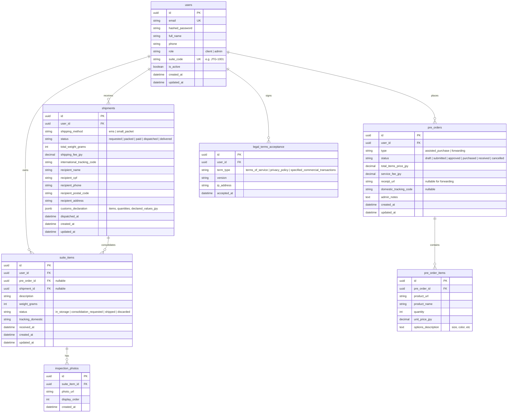
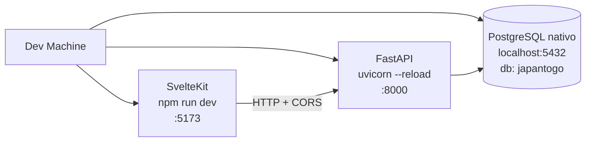

## Context

O JapanToGo é uma plataforma especializada em compras assistidas (代行 - Daikou) e redirecionamento de encomendas a partir do Japão para clientes no exterior (inicialmente Brasil). O negócio combina serviços digitais (cálculo de comissão, cotação de fretes internacionais, simulação de landed cost e declaração alfandegária) com operações físicas em galpão localizado no Japão (recebimento, identificação via código de suíte `#JTG-XXXX`, pesagem, inspeção fotográfica, consolidação e despacho via Japan Post EMS / Small Packet).

O MVP necessita de uma fundação tecnológica de alta performance, modular, tipada de ponta a ponta, com autenticação resiliente (JWT access + refresh), controle de acesso baseado em papéis (`client` e `admin`), interface web progressiva (PWA) e infraestrutura reproduzível com Docker Compose pronta para Coolify. O ambiente de desenvolvimento local é nativo (PostgreSQL em `localhost:5432`, `uvicorn --reload`, `npm run dev`), enquanto o empacotamento em contêineres é reservado ao deploy no Coolify.

## Goals / Non-Goals

**Goals:**
- Estabelecer a modelagem relacional completa em PostgreSQL 16 com SQLAlchemy 2.0 (async) e Alembic: tabelas `users`, `pre_orders`, `pre_order_items`, `suite_items`, `inspection_photos`, `shipments` e `legal_terms_acceptance`.
- Implementar backend em FastAPI (Python 3.12+) com Pydantic v2, autenticação JWT, refresh tokens em cookies HTTP-only, injeção de dependência para RBAC (`client` e `admin`) e endpoints REST para todos os módulos.
- Garantir a geração atômica e imutável de `suite_code` único no formato `JTG-XXXX` para cada usuário cliente no momento do cadastro.
- Implementar regra de negócio de Compra Assistida: taxa de 20% com piso mínimo de ¥ 2.000 para pedidos com valor de itens abaixo de ¥ 10.000.
- Implementar fluxo operacional de galpão (check-in de pacotes com busca rápida por suíte, pesagem em gramas, upload de fotos de inspeção e atualização de inventário).
- Implementar módulo de consolidação e exportação de envios para o padrão aceito pelo portal International Mail My Page da Japan Post.
- Implementar frontend em SvelteKit com Tailwind CSS v4, Lucide Svelte e suporte a PWA, estruturado em três grupos de layout: `(marketing)` para público, `(app)` para clientes e `(admin)` para operadores.
- Disponibilizar Landing Page institucional com identidade visual "JapanToGo - FROM JAPAN TO YOUR DOOR", simulador dinâmico de Landed Cost (conversão JPY->BRL, taxa da empresa, estimativa de frete por faixas de peso e projeção de impostos RTS 60% + ICMS) e páginas legais obrigatórias no Japão (利用規約, プライバシーポリシー, 特定商取引法に基づく表記).
- Disponibilizar configuração de contêineres Dockerfile multi-stage e `docker-compose.yml` otimizado para deploy no Coolify com volume persistente para mídias, consumindo um PostgreSQL externo via `DATABASE_URL`.
- Estabelecer um fluxo de desenvolvimento local **sem contêineres de banco de dados**: PostgreSQL nativo em `localhost:5432`, bootstrap do banco via `createdb japantogo` + `alembic upgrade head`, backend com `uvicorn --reload` e frontend com `npm run dev`.

**Non-Goals:**
- Integração direta via webhooks com gateways de pagamento em produção (Stripe/Square/Wise) no dia zero; o MVP estabelecerá o modelo de transação, cálculo e status de pagamento pendente/confirmado, deixando a liquidação via gateway ou link de cobrança manual/assistido até a aprovação cadastral das entidades japonesas.
- Webhooks automatizados da API corporativa da Japan Post (a Japan Post utiliza o sistema web manual "International Mail My Page", sendo o objetivo do MVP a exportação estruturada/CSV/clipboard para preenchimento ágil).
- Suporte a múltiplos galpões ou multi-moeda além de JPY (moeda base operacional no Japão) e BRL (moeda de simulação de destino).
- Provisionamento automático de PostgreSQL para desenvolvimento local: o banco é nativo e pré-existente na máquina do desenvolvedor; o bootstrap apenas cria o database `japantogo` e aplica as migrações.
- Execução do stack completo via `docker-compose up` no desenvolvimento local — o compose é artefato de deploy para o Coolify.

## Decisions

### 1. Backend: FastAPI + SQLAlchemy 2.0 (Async) + PostgreSQL 16
- **Decisão**: Utilizar FastAPI com async/await nativo, Pydantic v2 para validação e serialização rápida, e SQLAlchemy 2.0 com `asyncpg`.
- **Raciocínio**: Alta velocidade de I/O para operações concorrentes, tipagem estrita com Pydantic v2 gerando OpenAPI specs precisas para o frontend, e suporte nativo a migrações com Alembic.
- **Alternativas consideradas**:
  - *Django + DRF*: Mais pesado, ORM síncrono por padrão, overhead desnecessário para o design de API REST desacoplada.
  - *Node.js / Express ou NestJS*: Python oferece vantagens expressivas para manipulação de dados, automação futura de scraping de links japoneses e scripts de integração.

### 2. Frontend: SvelteKit + Tailwind CSS v4 + Lucide Svelte
- **Decisão**: Adotar SvelteKit com Tailwind CSS v4 e Lucide Svelte, configurado com adapter-node para servidor SSR/SPA híbrido e service worker para capacidades PWA.
- **Raciocínio**: SvelteKit fornece excelente performance, reatividade simplificada com Svelte 5 runes, separação limpa de rotas por layout groups (`(marketing)`, `(app)`, `(admin)`), e facilidade na construção de PWAs para uso mobile no galpão (câmera e upload direto).
- **Alternativas consideradas**:
  - *Next.js (React)*: Maior complexidade de renderização e estado, bundle size mais pesado e maior latência percebida em conexões móveis.

### 3. Modelo de Suíte (`suite_code`)
- **Decisão**: Gerar `suite_code` como sequência padronizada `JTG-XXXX` (iniciando em `JTG-1001`), atribuída de forma transacional e imutável a cada usuário com papel `client`.
- **Raciocínio**: Facilita identificação visual por operadores no galpão e serve como identificador universal em comprovantes de lojas online japonesas (Amazon JP, Rakuten, Mercari, Yahoo Auctions).
- **Alternativas consideradas**:
  - *UUID*: Ilegível para transportadoras japonesas e difícil de colar no campo de complemento de endereço japonês.

### 4. Armazenamento de Fotos de Inspeção e Recibos
- **Decisão**: Armazenar arquivos em volume local persistente montado no contêiner (`/app/uploads/`), servidos via rota estática autenticada/controlada pelo FastAPI no MVP, com abstração para S3/Cloudflare R2 no futuro.
- **Raciocínio**: Simplicidade operacional máxima no Coolify sem necessidade inicial de bucket externo pago, garantindo isolamento através de volumes Docker montados.
- **Alternativas consideradas**:
  - *Base64 no banco de dados*: Degradaria a performance do PostgreSQL e aumentaria o tamanho dos backups.

### 5. Estrutura de Rotas e RBAC
- **Decisão**:
  - Backend: Dependências FastAPI `get_current_user`, `require_client` e `require_admin` verificam claims do JWT assinado via HS256.
  - Frontend: Arquivos `+layout.server.ts` ou hooks de autenticação validam a role do usuário e redirecionam acessos indevidos.
- **Raciocínio**: Camadas de defesa redundantes tanto no roteamento do frontend quanto na validação de endpoints no backend.

### 6. Estratégia de Infraestrutura: PostgreSQL Nativo em Dev vs. Containers no Coolify

- **Decisão**:
  - **Desenvolvimento local**: o PostgreSQL roda **nativamente** na máquina do desenvolvedor na porta padrão `5432`. Nenhum contêiner de banco de dados é instanciado localmente. O backend sobe com `uvicorn --reload` e o frontend com `npm run dev`, ambos apontando para `localhost:5432`.
  - **Deploy (Coolify)**: `docker-compose.yml` é usado **exclusivamente** para empacotamento e publicação dos serviços `backend` e `frontend`. O banco de dados de produção é externo ao compose (serviço gerenciado pelo Coolify ou PostgreSQL dedicado) e é alcançado pela variável `DATABASE_URL`. As imagens usam `python:3.12-slim` e `node:22-alpine` (o SvelteKit 3 exige `Promise.withResolvers`, disponível a partir do Node 22).
  - **Conexão**: `DATABASE_URL` é a fonte única de verdade e sempre usa o driver assíncrono `postgresql+asyncpg://`. O Alembic lê **a mesma** URL a partir de `app.core.config.settings` em `alembic/env.py`, garantindo que migrações e aplicação nunca apontem para bancos diferentes. As variáveis discretas `DB_HOST`, `DB_PORT`, `DB_USER`, `DB_PASSWORD` e `DB_NAME` existem no `.env.example` como forma alternativa de compor a URL quando `DATABASE_URL` não for informada.
  - **Segredos e sessão**: `JWT_SECRET` (aceito também como alias `SECRET_KEY`) assina os tokens; `COOKIE_DOMAIN` define o domínio do cookie HTTP-only de refresh.
- **Raciocínio**: elimina a duplicação de stacks (dev nativo vs. container) e o custo de subir/derrubar um contêiner de banco a cada ciclo de desenvolvimento, sem perder reprodutibilidade em produção. Uma única URL de conexão elimina a classe de erro "a migração rodou em outro banco que a aplicação".
- **Alternativas consideradas**:
  - *PostgreSQL em contêiner para desenvolvimento*: acrescenta latência a cada ciclo de `up`/`down` e exige Docker Desktop ativo, sem ganho funcional para o time.
  - *`sqlalchemy.url` estático no `alembic.ini`*: risco permanente de divergência entre o banco usado pela aplicação e o usado pelas migrações.
  - *URLs separadas para dev e produção dentro do mesmo compose*: mantém a ambiguidade de "qual banco estou usando agora?".

### 7. Estratégia de Mídia Local com Volume Montado

- **Decisão**: uploads (fotos de inspeção, comprovantes) persistem no volume `uploads` montado em `/app/uploads` dentro do contêiner do backend.
- **Raciocínio**: o caminho é idêntico em dev (diretório local `backend/uploads/`) e em produção (volume Docker nomeado), o que evita condicionais de caminho no código.
- **Alternativas consideradas**: *upload direto para S3/R2* — adiado por custo e complexidade no MVP.

## Data Model & Relational Schema



## Architecture & Directory Structure

```
japantogo/
├── docker-compose.yml          # Coolify/produção apenas (backend + frontend)
├── .env.example                # variáveis compartilhadas (raiz)
├── scripts/
│   └── setup_local_db.sh       # bootstrap do banco local nativo
├── backend/
│   ├── Dockerfile
│   ├── .dockerignore
│   ├── .env.example
│   ├── requirements.txt
│   ├── alembic.ini
│   ├── alembic/
│   │   ├── env.py              # lê a MESMA DATABASE_URL da aplicação
│   │   └── versions/
│   └── app/
│       ├── main.py
│       ├── core/
│       │   ├── config.py
│       │   ├── database.py
│       │   ├── security.py
│       │   └── dependencies.py
│       ├── models/
│       │   ├── __init__.py
│       │   ├── user.py
│       │   ├── pre_order.py
│       │   ├── suite_item.py
│       │   ├── shipment.py
│       │   └── legal.py
│       ├── schemas/
│       │   ├── auth.py
│       │   ├── pre_order.py
│       │   ├── suite_item.py
│       │   ├── shipment.py
│       │   └── calculator.py
│       ├── services/
│       │   ├── suite_service.py
│       │   ├── fee_calculator.py
│       │   ├── japan_post_export.py
│       │   └── file_storage.py
│       └── api/
│           ├── v1/
│           │   ├── api.py
│           │   ├── auth.py
│           │   ├── users.py
│           │   ├── pre_orders.py
│           │   ├── suite.py
│           │   ├── shipments.py
│           │   ├── calculator.py
│           │   └── admin/
│           │       ├── dashboard.py
│           │       ├── warehouse.py
│           │       ├── pre_orders.py
│           │       └── shipments.py
└── frontend/
    ├── Dockerfile
    ├── package.json
    ├── svelte.config.js
    ├── vite.config.ts
    ├── tailwind.config.js
    ├── .env.example
    ├── src/
    │   ├── app.html
    │   ├── app.d.ts
    │   ├── lib/
    │   │   ├── api/
    │   │   │   └── client.ts
    │   │   ├── stores/
    │   │   │   └── auth.ts
    │   │   ├── components/
    │   │   │   ├── ui/
    │   │   │   ├── LandedCostCalculator.svelte
    │   │   │   ├── AddressCard.svelte
    │   │   │   └── PhotoGallery.svelte
    │   │   └── utils/
    │   │       ├── currency.ts
    │   │       └── formatters.ts
    │   └── routes/
    │       ├── (marketing)/
    │       │   ├── +page.svelte (Landing Page)
    │       │   ├── simulador/+page.svelte
    │       │   ├── termos/+page.svelte
    │       │   ├── privacidade/+page.svelte
    │       │   └── tokushoho/+page.svelte
    │       ├── (auth)/
    │       │   ├── login/+page.svelte
    │       │   └── register/+page.svelte
    │       ├── (app)/
    │       │   ├── +layout.svelte (Client App Shell)
    │       │   ├── dashboard/+page.svelte
    │       │   ├── endereco/+page.svelte (Suite info)
    │       │   ├── pre-pedidos/
    │       │   │   ├── +page.svelte
    │       │   │   ├── novo-assistida/+page.svelte
    │       │   │   └── novo-redirecionamento/+page.svelte
    │       │   ├── suite/+page.svelte (Estoque & Fotos)
    │       │   └── envios/
    │       │       ├── +page.svelte
    │       │       └── novo/+page.svelte (Consolidação & Declaração)
    │       └── (admin)/
    │           ├── +layout.svelte (Admin Shell)
    │           ├── admin/
    │           │   ├── dashboard/+page.svelte
    │           │   ├── pre-pedidos/+page.svelte
    │           │   ├── warehouse-checkin/+page.svelte (Câmera & Peso)
    │           │   └── envios/+page.svelte (Exportação Japan Post)
```

### Fluxo de Desenvolvimento Local (nativo, sem contêineres de banco)



Ordem de bootstrap:

1. `cp backend/.env.example backend/.env` e preencher `DATABASE_URL` / `DB_*` / `JWT_SECRET`.
2. `scripts/setup_local_db.sh` (ou `createdb japantogo` + `alembic upgrade head`).
3. `uvicorn app.main:app --reload` em `backend/`.
4. `npm run dev` em `frontend/`.

## Risks / Trade-offs

- **[Risco: Concorrência na geração de `suite_code`]** → **Mitigação**: Uso de sequence nativa do PostgreSQL (`suite_code_seq`) formatada como `'JTG-' || lpad(nextval('suite_code_seq')::text, 4, '0')` com constraint UNIQUE, eliminando colisões de concorrência.
- **[Risco: Armazenamento excessivo de fotos de inspeção]** → **Mitigação**: Redimensionamento e compressão WebP no upload via Pillow no backend (max 1920x1080, qualidade 85%), limitando a 5 fotos por item e máx 5MB por upload.
- **[Risco: Variação cambial JPY -> BRL no Simulador]** → **Mitigação**: Endpoint `/api/v1/calculator/simulate` armazena cotação de referência com margem cambial parametrizável (spread de segurança) e carimbo de data/hora explícito avisando o cliente sobre flutuação cambial.
- **[Risco: Bloqueio de Gateways de Pagamento por falta de conformidade legal japonesa]** → **Mitigação**: Disponibilização integral das páginas legais exigidas pela legislação japonesa (Tokushoho) contendo dados empresariais, métodos de pagamento aceitos, política de devolução/cancelamento e prazos de entrega em japonês e português.
- **[Risco: Divergência entre o banco usado pela aplicação e o usado pelas migrações]** → **Mitigação**: `DATABASE_URL` é a fonte única de verdade; `alembic/env.py` importa `app.core.config.settings` e injeta a mesma URL em `sqlalchemy.url`. Não existe `sqlalchemy.url` estático no `alembic.ini`.
- **[Risco: Configuração local e de produção divergirem silenciosamente]** → **Mitigação**: o `.env.example` do backend documenta explicitamente as duas formas de conexão (URL completa ou variáveis `DB_*` discretas), e o bootstrap local (`scripts/setup_local_db.sh`) falha de forma explícita quando o PostgreSQL nativo em `localhost:5432` não está acessível.
